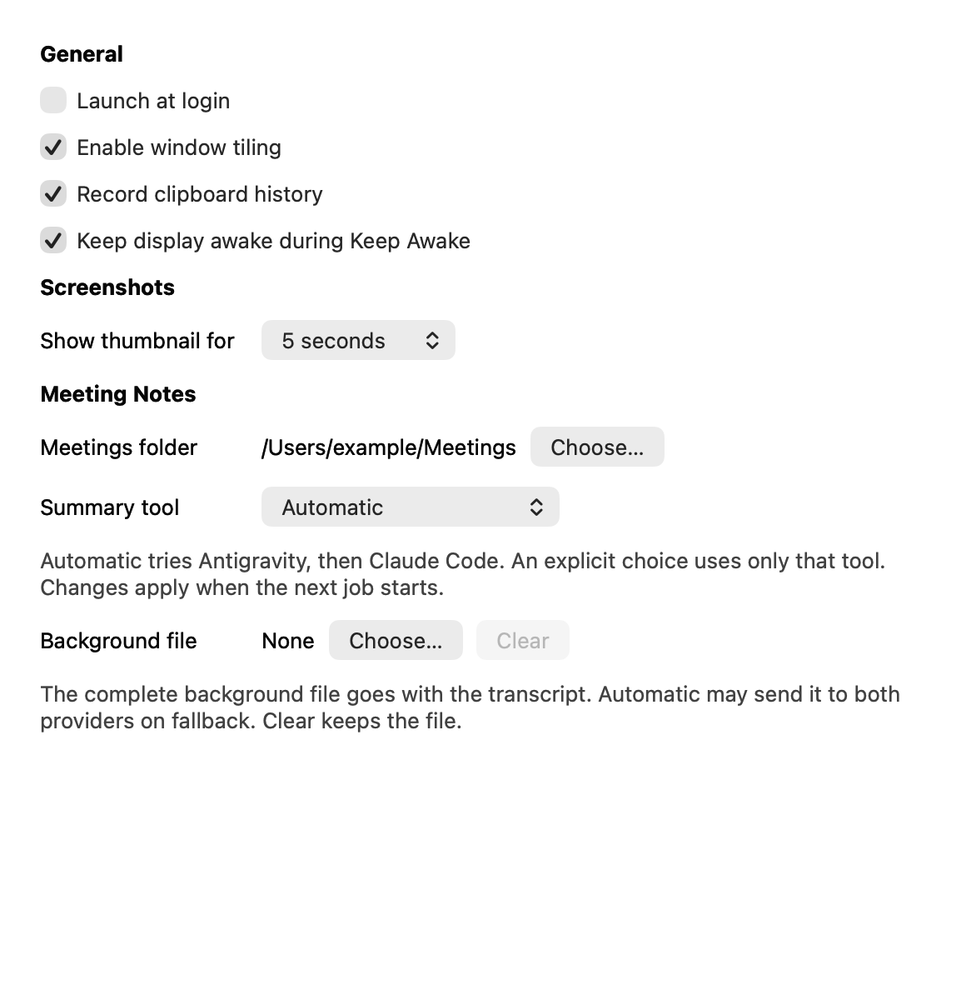

# Settings window verification

## Inventory and behavior

The previous menu held launch at login, window tiling, clipboard history, and thumbnail duration. The Keep Awake panel held the display-awake checkbox. Meeting Notes held Choose Meetings Folder. These controls now live in one retained, grouped, scrollable Settings window.

| Preference | Stored key or owner | Default |
|---|---|---|
| Launch at login | `LoginItemManaging` | Actual service state |
| Enable window tiling | `windowTilingEnabled` | true |
| Record clipboard history | `clipboardHistoryEnabled` | true |
| Show thumbnail for | `thumbnailDuration` | 5 seconds |
| Keep display awake during Keep Awake | `keepDisplayAwake` | true |
| Meetings folder | `meetingsFolder` | `~/Meetings` |
| Summary tool | `summaryTool` | automatic |
| Background file | `meetingContextFile` | None |

Thumbnail choices always include 3, 5, 15 seconds, and Forever. A saved custom value appears as Custom and stays intact until the user selects another value. Opening Settings only reads preferences. The existing known-words path follows a changed meetings folder unless the user has set an explicit path.

The menu retains Keep Awake duration and Turn Off, recording controls, Show Meeting Controls, Restore Default Position, Check Words, Retry, Open Meetings Folder, permissions, help, and Quit. Settings has Command-comma. Command-W closes its window directly, including when there is no application menu.

Automatic tries Antigravity, then Claude Code. An explicit selection uses only that tool. The queue reads the choice when a job starts. Background Choose and Clear use the existing context setting. Clear never deletes the file. The complete accepted context file goes to the selected provider with the transcript.

Calendar #28 and Teams #41 can add controls to the Meeting Notes group after their owners supply typed state and actions. No integration controls or calendar operations are part of this change.

## Executable checks

`SettingsWindowControllerTests` drives native button clicks and popup target actions with isolated defaults, a fake login service, injected pickers, and injected presentation. It covers saves, typed runtime callbacks, all thumbnail and summary choices, picker acceptance and cancellation, context clearing, login failure, reopening, custom values, full accessible paths, width, scrolling, and explicit key-view order.

The same suite sends native Command-W events and checks actual onboarding and word-review windows in both close orders beside Settings. Each test closes its windows. `StatusMenuTests` sends Command-comma through the application menu, checks the single Settings entry, and rejects persistent preference controls in the status menu.

`main.swift` selects the launch host once. XCTest has no app delegate and never constructs production services. `--uitesting` selects `SettingsPreviewAppDelegate` with isolated `KuKa.TestHost` defaults, an inert login service, Settings, and the static menu. XCTest takes priority when both markers exist. `AppLaunchModeTests` checks selection and invokes both preview Settings commands with injected presentation and activation. The revised `--uitesting` host was not launched on the desktop during this task.

Use one runner with DerivedData in `build/task-verification`:

```sh
xcodebuild -project KuKa.xcodeproj -scheme KuKa -destination 'platform=macOS' \
  -derivedDataPath build/task-verification test \
  -only-testing:KuKaTests/AppLaunchModeTests \
  -only-testing:KuKaTests/SettingsWindowControllerTests \
  -only-testing:KuKaTests/SettingsTests \
  -only-testing:KuKaTests/StatusMenuTests \
  -only-testing:KuKaTests/KeepAwakeControllerTests \
  -only-testing:KuKaTests/OnboardingWindowControllerTests \
  -only-testing:KuKaTests/WordReviewWindowTests \
  -only-testing:KuKaTests/MeetingNotesControllerTests \
  -only-testing:KuKaTests/MeetingNotesCheckWordsTests \
  -only-testing:KuKaTests/SummaryToolJobTests
```

## Test results and method

The B1 host regression first failed against `02ed968` with `XCTAssertFalse failed - XCTest must not construct the production AppDelegate`. After host separation and the S1 thumbnail refactor, the focused `AppLaunchModeTests` and `SettingsWindowControllerTests` run passed 17 tests with no failures. The result bundle is `build/task-verification/Logs/Test/Test-KuKa-2026.10.29_17-28-14-+0200.xcresult`. S1 used the existing native-action and saved-custom-value tests, with literal menu labels instead of row-index and tag assumptions. The earlier full-suite results below remain historical; the parent task runs the final full suite.

The final full KuKaTests run at `c30fcba` passed 820 tests, skipped 5, and failed none. The result bundle is `build/task-verification/Logs/Test/Test-KuKa-2026.10.29_17-34-15-+0200.xcresult`. Earlier full runs at `18593df` and `3a7037b` passed 818 and 817 tests, respectively.

The skipped tests are the optional meeting-panel image capture, two real live-transcript tests, the real Whisper audio test, and the real SpeakerKit test. They need explicit fixture or model paths and were not enabled. Xcode reported the existing CoreDevice and CoreSimulator mismatches, the Info.plist resource warning, and a thread-priority warning in WordReviewWindowTests. The run was successful, not warning-free.

The summary-tool and native-control changes used observed red-green test cycles. The separate menu-migration red check was retrospective. It confirmed that the new test rejects the old menu, but it did not follow the planned test-before-migration order.

The final login regression test failed before the fix with a visible old error and the text difference `"Could not change launch at login. Registration refused"` versus `""`. After the fix, 34 focused Settings tests passed. The final full suite includes that regression.

### Judo review follow-up

- B1 is addressed. `main.swift` selects the production delegate, the isolated Settings preview, or the passive XCTest host once. `AppDelegate` has no test-mode branches or test-only settings access. The new host test failed against the former production delegate before implementation, then passed with the passive host. The preview tests use isolated preferences and injected presentation and activation.
- S1 is addressed. One table defines thumbnail titles and duration values. Refresh and native selection use those values, with no preset-count or row-index rule. Existing behavior tests cover every standard choice and the saved custom value. The form's labels and layout remain unchanged.

Commit `015696c` implements these changes. Its 17 focused tests passed, but the first full run exposed two assertions in one preview test that required a missing preferences domain. macOS returned an empty dictionary instead. Commit `c30fcba` corrects the assertions to require no stored values and shares the native window-presentation operation between production and preview. The 17 focused tests and final full suite passed afterward.

The independent scoped review accepted B1 and S1 and requested removal of the duplicated presentation closure. The correction review accepted that extraction and the empty-domain assertion fix with no new findings. The standalone debug app remained closed; the final process check found no worktree app or test host running.

## Native rendering evidence



`testNativeAccessibilityNamesKeyOrderAndOffscreenRendering` renders the native content view through `bitmapImageRepForCachingDisplay` and `cacheDisplay`. The attachment uses Aqua appearance, a 580 by 600-point viewport, and a 1160 by 1200-pixel Retina bitmap. It contains synthetic paths and an inert login service. The image was exported from XCTest and visually inspected. The scroll background is made opaque for the capture. The window is never ordered onscreen by this test.

The before state is the source inventory above. The earlier live baseline attempt timed out, and the user then stopped the debug app. The app stayed closed. This image is an offscreen native render, not live UI validation.

## Remaining real-world checks

- Walk the native form with Tab and Shift-Tab, and check focus rings and picker focus return.
- Check names, values, and login error announcements with VoiceOver.
- Check real login registration and native file sheets in a signed app.
- Check light and dark appearance on the desktop.
- Check editor focus after Settings closes, and Command-A, C, X, V, and Z in the word-review text field.

Independent task reviews approved the summary policy and the Settings migration. The whole-branch review found no Critical or Important issues and requested two minor fixes. Commit `18593df` clears stale login feedback on reopen and corrects the fallback wording in AGENTS.md. The scoped fix review approved both changes with no new findings. The comment review found no added comments or suppressions to remove.

The evidence audit used gpt-6.1-sol and found no material inconsistencies against the supplied session digest. Its remaining flags are the real-world checks above and the documented retrospective menu check. No app was installed, no branch was pushed or merged, and no pull request or issue update was published.
