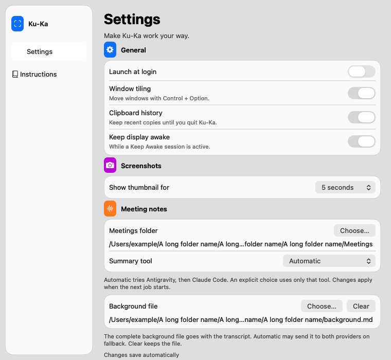
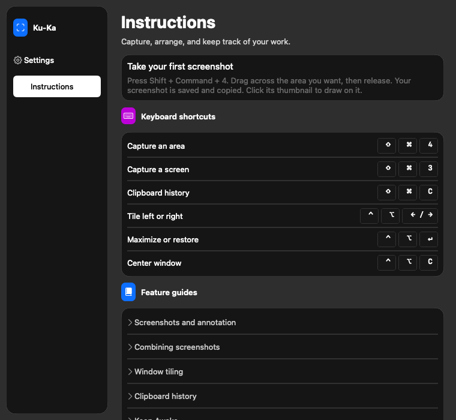

# Liquid Settings verification

## Native implementation

The retained Settings window starts at 760 by 700 points and allows resizing down to 640 by 420 points. A 170-point floating sidebar selects Settings or Instructions through one `SettingsPage` value. `show()` always selects Settings. Each page scrolls separately. Four native switches replace the former checkboxes. All eight preference actions, immediate saves, injected sheets, typed callbacks, custom thumbnail values, login errors, and accessible full paths remain.

`SettingsWindowViews.swift` supplies native `NSGlassEffectView` groups and a native window material. Reduce Transparency replaces these materials with solid system colors and changes navigation to solid native buttons. Increase Contrast strengthens group borders. Colors resolve again when appearance changes. Page changes have no animation.

Instructions has no production services. It contains a screenshot example, six shortcut rows with readable keycap names, and seven guides. Full-width native toggle buttons with disclosure accessibility roles expand the guides. Their minimum height is 28 points. The screenshot guide includes drawing, Undo, Crop, Done, and deletion. Copy was checked against `HotkeyShortcut`, `SelectionView`, `EditorWindow`, `CropOverlayView`, `ThumbnailStackManager`, `KeepAwakeController`, and the existing project guidance.

## Existing tests

The focused command is:

```sh
xcodebuild -project KuKa.xcodeproj -scheme KuKa -destination 'platform=macOS' \
  -derivedDataPath build/task-verification test \
  -only-testing:KuKaTests/AppLaunchModeTests \
  -only-testing:KuKaTests/SettingsWindowControllerTests \
  -only-testing:KuKaTests/SettingsTests \
  -only-testing:KuKaTests/StatusMenuTests
```

The full command is:

```sh
xcodebuild -project KuKa.xcodeproj -scheme KuKa -destination 'platform=macOS' \
  -derivedDataPath build/task-verification test -only-testing:KuKaTests
```

Results are in `build/task-verification/Logs/Test/`.

| Result bundle timestamp on 2026-10-30 | Scope | Result |
| --- | --- | --- |
| 14-03-19 | Focused | 48 tests, three failed assertions in two tests. The old root-scroll-view and closed nine-control key cycle assumptions no longer applied. |
| 14-03-53 | Focused | 48 passed. |
| 14-06-27 | Focused | 48 passed after alignment and glass-content changes. |
| 14-07-08 | Full | 825 executed, 820 passed, five skipped, zero failures. |
| 14-08-34 | Focused | 48 passed after solid root fallback and compact spacing. |
| 14-09-50 | Focused | 48 passed after trailing stack alignment. |
| 14-18-11 | Focused | Two geometry assertions failed. The native disclosure bezel forced a narrow button and changed layout. |
| 14-18-56 | Focused | 48 passed after switching to full-width native disclosure buttons. |
| 14-19-46 | Final focused | 48 passed after explicit disclosure glyph and accessible expanded-state updates. |
| 14-25-08 | Final full | 825 executed, 820 passed, five skipped, zero failures at implementation commit `9c226db`. |

The first full run used an uncommitted intermediate implementation based on `aeea754b039452f37c2e1c8fbda073e2f498885f`. The final implementation adds solid root and navigation fallbacks, compact spacing, trailing alignment, crop instructions, and the full-width disclosure controls after that run. During independent review, the controller confirmed 48 passing tests in the final focused result. Xcode had pruned the earlier full bundle, so the controller ran the full suite again at `9c226db`. The final full command exited 0. `xcresulttool get test-results summary` confirmed 820 passed, five skipped, zero failures in `Test-KuKa-2026.10.30_14-25-08-+0200.xcresult`. Older bundles in the shared DerivedData directory can be pruned by Xcode.

Only two existing test methods changed. The long-path test now finds the visible scroll view inside the page container, expects a 760-point starting width, compares the path width to the page viewport, and checks scrolling at 640 by 420 points. The native rendering test includes both navigation buttons in the key cycle, finds the visible page scroll view, and uses the new 760 by 700 size and bitmap ratio. No test methods or test cases were added.

The five skipped checks are the optional meeting-panel picture, two real live-transcript checks, real Whisper audio, and real SpeakerKit audio. No real fixtures or model downloads were enabled. Xcode reported its existing CoreDevice and CoreSimulator mismatch, duplicate destination, Info.plist resource, actor-conversion, and word-review thread-priority warnings. Native background service messages also appeared. This was a successful run with warnings.

## Native evidence and method

The temporary renderer linked the actual built `KuKa.debug.dylib` through `@testable import KuKa`. It constructed only Settings with an inert login service, cancelled picker callbacks, an inert presenter, and isolated defaults. It never ordered a window onscreen or constructed `AppDelegate`. The synthetic paths did not need to exist. It removed its preference domain on exit. Its action assertions stayed in the ignored task workspace, outside the committed source and test suites. The temporary source was removed after independent review. The committed evidence consists of images and this record.

The task used this command from the repository root after the focused build. Its temporary source is not a retained reproduction tool.

```sh
xcrun swiftc -parse-as-library \
  -I build/task-verification/Build/Products/Debug/Modules \
  -I build/task-verification/Build/Products/Debug \
  build/task-verification/Build/Products/Debug/KuKa.app/Contents/MacOS/KuKa.debug.dylib \
  -Xlinker -rpath -Xlinker "$PWD/build/task-verification/Build/Products/Debug/KuKa.app/Contents/MacOS" \
  .superpowers/sdd/2026-10-30-settings-liquid/render.swift \
  -o .superpowers/sdd/2026-10-30-settings-liquid/render
.superpowers/sdd/2026-10-30-settings-liquid/render
```

The renderer checks both native navigation actions, selected page and first responder, no preference writes on navigation or guide actions, reopening on Settings, seven guide expand/collapse actions, the Instructions key-view cycle, full path values and tooltips, switch names, horizontal bounds, and injected solid backgrounds and contrast borders. Existing tests check the Settings key-view cycle and preference actions. These are native target-action and key-view checks, not a live Tab or VoiceOver session.

All 12 PNGs under `docs/superpowers/evidence/settings-liquid/` were visually inspected. They include both pages in Aqua and Dark Aqua at 760 by 700 and 640 by 420 points, expanded Instructions at the top and bottom, and light/dark solid contrast variants. Settings has a 717-point document; Instructions has an 827-point collapsed document at starting width and an 843-point document at the smaller width. The expanded document is 1438 points. All eight preferences and the background disclosure are visible at the starting size. Smaller windows retain the sidebar and scroll the content.





Comparison with B / `.bold` confirms the floating rounded sidebar, native selection, colored feature icons, right-aligned controls and keycaps, and quiet rounded preference groups. Paths occupy their own line to keep long names and file actions usable. The native form is denser than the first render so all preferences remain visible at starting size. No browser gradients or simulated material layers were added. The old baseline remains at `settings-window/settings-offscreen-aqua-580x600.png`.

## Limits

`cacheDisplay` produces opaque offscreen material in these images. It does not prove live desktop glass, blur, reflections, focus rings, or active control color. Switches show inactive gray tracks because the window is never key onscreen. The selected navigation image is not visible in the native glass capture, while the same image is visible with the solid native button style. The image and image position remain configured in source. This is a material-specific offscreen observation; live selected-icon rendering is unverified.

No production or preview app was launched. No meetings were read, models downloaded, or OS preferences changed. Reduce Transparency and Increase Contrast used `applyDisplayOptions` on the views, with solid-background and border assertions. A live VoiceOver session, physical keyboard focus rings, signed login registration, native file-sheet focus return, and real desktop material composition remain unverified.

## Independent review

The scoped review approved spec compliance and code quality after checking the committed diff, the temporary native probe, and all 12 images against B. A separate comment review found no comments or suppressions to remove. The whole-branch review independently confirmed the final focused and full test summaries and inspected all 12 images. Both code reviews found no Critical or Important issues. One Minor remains for live selected-icon visibility. The reviews support the bounded layout and action claims, with the desktop limits above. No publication or merge occurred.
